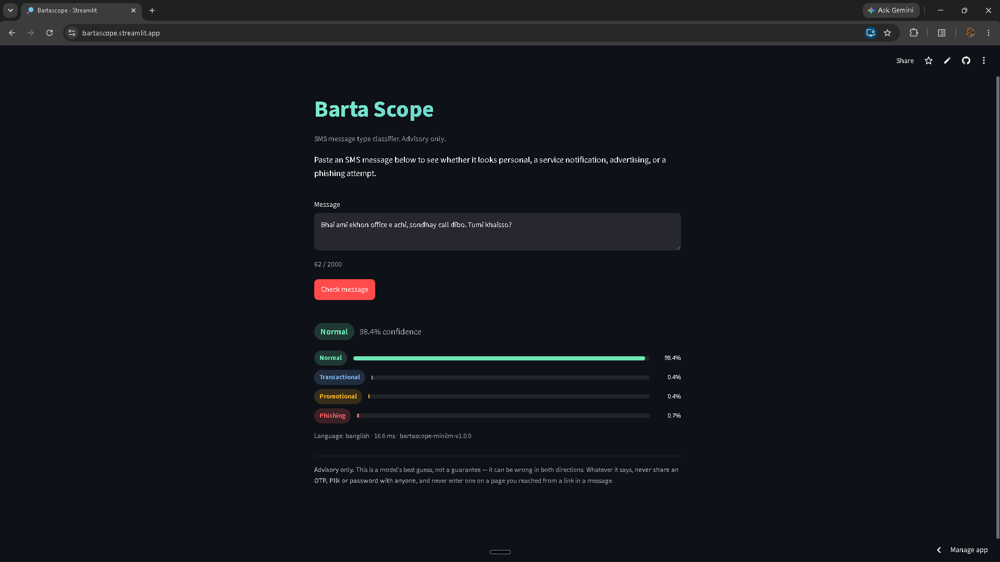
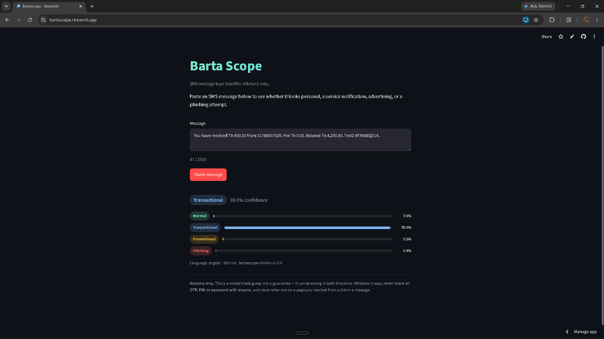
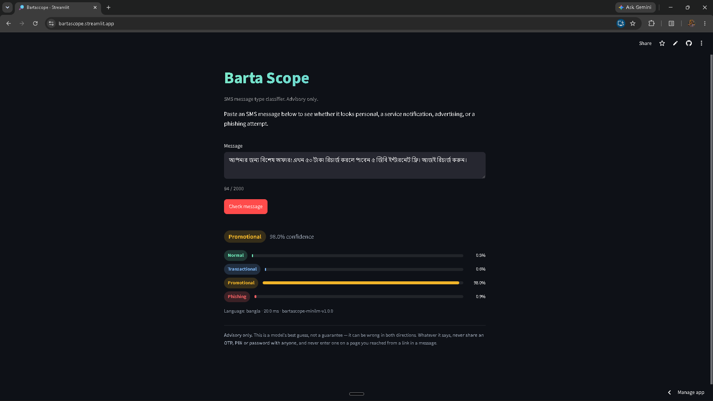
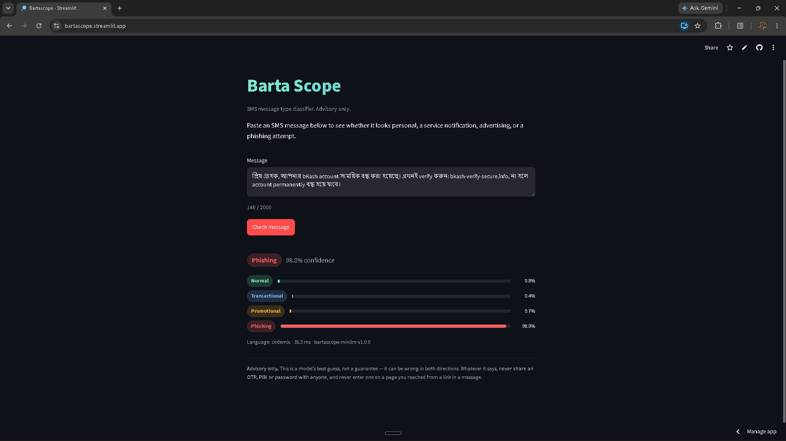

# Bartascope

> Paste an SMS, find out what kind of message it is — personal, a genuine service notification, advertising, or a phishing attempt. Bangla, English, banglish and code-mixed text all go through the same model.


[](https://www.python.org/)
[](https://fastapi.tiangolo.com/)
[](https://onnxruntime.ai/)
[](https://www.docker.com/)
[](https://huggingface.co/)


**App Live Link**: https://bartascope.streamlit.app/

---

## Why & What

- **The problem:** phishing SMS in Bangladesh mimics real bank and MFS alerts closely enough that people can't reliably tell them apart, and existing spam filters are built for English.
- **What Bartascope does:** classifies any pasted message — Bangla, English, or mixed — into normal, transactional, promotional, or phishing, in single-digit milliseconds.
- **What this project is actually about:** the engineering, not the accuracy. Pretrained model → ONNX export → optimization → a production FastAPI microservice → Docker → load testing → deployment. Every number below was measured, not assumed, and the two least comfortable findings are reported as plainly as the ones that look good.
- **The honest headline:** a 5 MB logistic regression beats the deployed 118M-parameter transformer on accuracy, at 23× lower latency. That's in here on purpose — see [What this project actually found](#what-this-project-actually-found).

> Building on this? `CLAUDE.md` is the full working log — every measurement, every rejected approach, and why.

---

## Tech Stack

| Layer | Technology |
|---|---|
| Model | `microsoft/Multilingual-MiniLM-L12-H384`, fine-tuned |
| Inference | ONNX Runtime (fp32), served via `onnxruntime` — no torch in the runtime image |
| Tokenizer | `tokenizers` (raw, not `transformers` — see below) |
| Service | FastAPI, async, ORT session loaded once in `lifespan` |
| Load shedding | `asyncio.Semaphore` + threadpool inference + bounded queue timeout |
| Container | Multi-stage Docker, 523 MB pulled |
| Load testing | k6, two profiles (constant arrival rate, idle-then-burst) |
| Frontend | Two builds — a static page served by FastAPI, and a Streamlit app for the free public deploy |
| Model hosting | Hugging Face model repo (weights are too large for free GitHub LFS) |
| Baseline | TF-IDF char n-grams + logistic regression, `scikit-learn` |

---

## What this project actually found

Three results that shaped the final build, reported before anything else.

**1. The classical baseline wins on accuracy.**

| Model | Params | test macro-F1 | p95 latency | Hardware |
|---|---|---|---|---|
| TF-IDF char n-gram + LogReg | — | **0.9787** | **0.55 ms** | local |
| **MiniLM L12-H384 (deployed)** | 118M | 0.9695 | 12.91 ms | local |
| XLM-R base | 278M | 0.9645 | 93.29 ms | Kaggle — not comparable |

A 5 MB model beats a 278M-parameter transformer, at 23× lower latency than the transformer that *is* deployed. It isn't shipped, because the project's goal was serving a transformer via ONNX — but the comparison is the strongest evidence in the whole write-up, and it's why MiniLM (not XLM-R) was the model chosen for optimization.

**2. ONNX alone did not hit the 2× target — and INT8 was rejected for a reason F1 doesn't show.**

| | ONNX fp32 (deployed) | INT8 (rejected) |
|---|---|---|
| size | 472 MB | 119 MB |
| p95 (batch 1, dynamic padding) | 9.14 ms | 5.55 ms |
| speedup vs PyTorch | 1.34× | 2.21× |
| macro-F1 | 0.9695 | 0.9547 |
| phishing missed as normal | 4 | **13** |

INT8 would have hit the 2× target. It's not shipped: quantization tripled phishing false negatives while phishing's F1 barely moved (−0.004) — precision rose as recall fell, and F1 hid the trade entirely. For a safety classifier, a scam message read as "normal" is the worst direction to regress in. **Goal 2 is explicitly not met by what ships**, and that's stated as a result, not softened.

**3. Data quality varies by source, and the model shows it.**

The Bangla source dataset is almost certainly synthetic (near-uniform label/language balance, 1,095 phone mentions from 266 unique numbers, heavy templating). A logistic regression predicts *which dataset* a message came from with 96.2% accuracy against a 53.1% baseline — the sources are trivially separable. Consequence: MiniLM scores 0.978 macro-F1 on synthetic Bangla and 0.890 on real Mendeley English SMS. `transactional` is English-only in the data, and that's a fact about the world, not a gap — Bangla SMS forces UCS-2 encoding (70 chars vs 160), so Bangladeshi banks send alerts in English.

---

## How it works

### Serving pipeline

```
Pasted message
  → normalise() — URLs to domain-only, phones to <PHONE>, OTP digits to <CODE>
    (the model was fine-tuned on this exact normalisation; skipping it is
    silent train/serve skew, not a crash)
  → tokenise (tokenizers, not transformers — see below)
  → acquire a concurrency slot (bounded semaphore, sized from the load test)
       ↓ shed 503 if no slot within 200ms
  → run in a worker thread (ORT releases the GIL; inline would block the
    event loop and make the timeout unable to fire)
  → softmax → four probabilities, fixed label order
  → JSON: label, all four probabilities, detected language, model_version,
    inference_ms
```

### Why `transformers` isn't in the runtime path

`AutoTokenizer` pulled in the full `transformers` package for one function. Measured: 385 MB of the 923 MB peak process memory was the import alone, before touching the model. Swapped for `tokenizers` directly — verified byte-identical `input_ids`/`attention_mask` across all 200 test messages, individually and batched, then re-ran the full 1,923-row evaluation to confirm macro-F1 was unchanged (0.9695, exact). Peak memory dropped to 427 MB. This is also what makes the Streamlit deploy fit under its 1 GB ceiling.

### Load shedding

The first load test found the service had none: at 240 rps offered, it answered every request correctly after a 42-second wait. Nothing shed. Fixed with a semaphore sized to the thread count plus a 200ms queue timeout:

| offered rps | | p95 | shed |
|---|---|---|---|
| 90 | before / after | 21.63 / 17.64 ms | 0% |
| 120 | before / after | 1331.44 / 213.41 ms | 3.5% |
| 240 | before / after | **42250.80 / 257.17 ms** | 58.1% |

164× better p95 at 240 rps by refusing 58% of it — and it made the service's overload behaviour *reproducible*: before shedding, the knee at 95 rps measured 45 ms in one run and 352 ms in another. After, two runs agree within 3 ms.

---

## Project structure

```
bartascope/
│
├── app/
│   ├── main.py            # FastAPI: 5 endpoints, lifespan-loaded ORT session
│   ├── model.py            # Classifier wrapper, thread config from cgroup quota
│   ├── textproc.py         # normalise() / detect_lang() — shared with the dataset builder
│   ├── metrics.py          # hand-rolled Prometheus exposition
│   ├── schemas.py
│   └── static/index.html   # the FastAPI-served frontend
│
├── streamlit_app.py         # second frontend — free public deploy, model pulled from HF at cold start
│
├── scripts/
│   ├── prepare_dataset.py       # merge, redact, dedupe, stratified+group-aware split
│   ├── baseline_tfidf.py        # the model that wins
│   ├── train_transformer.py     # model-agnostic — checkpoint is a CLI flag
│   ├── export_onnx.py           # export + parity check (<1e-4 or it stops)
│   ├── quantize_onnx.py         # INT8 — kept for the record, not for deployment
│   ├── evaluate_onnx.py         # per-class/language/source eval, any .onnx file
│   ├── benchmark.py              # backend x batch x padding sweep
│   ├── benchmark_api.py          # end-to-end HTTP latency
│   └── loadtest.py               # k6 driver, liveness-guarded
│
├── load/                    # k6 profiles: constant_arrival.js, idle_burst.js
├── Dockerfile               # torch-free runtime image
├── Dockerfile.pytorch       # baseline-reproduction image only, never a serving image
├── docker-entrypoint.sh     # BARTASCOPE_THREADS from cgroup CPU quota
├── benchmarks/              # every measured row — the whole latency story
│   ├── latency.csv
│   ├── eval_fp32.json / eval_int8.json / eval_int8_matmul.json
│   └── export_info.json
├── models/
│   ├── results.json, errors.csv, confusion_matrix.csv   # MiniLM's recorded numbers
│   ├── minilm/           # PyTorch checkpoint (gitignored — see below)
│   └── baseline/         # TF-IDF model.joblib (gitignored — regenerate via baseline_tfidf.py)
├── onnx_out/                # exported ONNX graph + tokenizer (gitignored — see below)
├── tests/smoke_api.py       # 26 checks, real model, no mocks, in-process or --base-url
└── CLAUDE.md                # the working log (gitignored)
```

Model weights (`model.onnx`, `model.onnx.data`, tokenizer files) are hosted on [Hugging Face](https://huggingface.co/SahadatIslam/bartascope-minilm), not in this repo — GitHub's free LFS bandwidth (1 GB/month) can't hold a 472 MB artifact under repeated redeploys. The PyTorch checkpoint and TF-IDF baseline are gitignored too, since both are reproducible from `scripts/train_transformer.py` and `scripts/baseline_tfidf.py` respectively.

---

## Data

Four classes, 12,808 rows merged from two public SMS datasets plus 350 messages collected from real phones (English-only — see finding 3 above): `normal`, `transactional`, `promotional`, `phishing` (spam folded into promotional; the source schemes disagreed on the boundary). Split stratified on `(label, language)` jointly, with whole template families kept in one split — a plain random split would leak near-duplicate templated SMS across train/test and inflate every number in this README.

Full label taxonomy, redaction rules, and the source-separability check are in `CLAUDE.md`.

---

## Local setup

**1. Clone and install**

```bash
git clone https://github.com/SahadatIslamAsif/BartaScope.git
cd BartaScope
python -m venv .venv
.venv\Scripts\pip install -r requirements-runtime.txt   # serving only
```

**2. Get the model**

Weights live on Hugging Face:

```bash
.venv\Scripts\hf download SahadatIslam/bartascope-minilm --local-dir onnx_out
```

**3. Run the service**

```bash
.venv\Scripts\uvicorn app.main:app --port 8080
```

Open `http://127.0.0.1:8080`.

**4. Or run the container**

```bash
docker build -t bartascope .
docker run --rm -p 8099:8080 --cpus 2 bartascope
```

---

## Deployment

Cloud Run, Fly.io, Hugging Face Spaces and Render were each ruled out — a card requirement, a free-tier removal, or too little memory for a 470 MB model. Deployed instead on **Streamlit Community Cloud**: free, no card, ~1 GB memory. The model is pulled from the [Hugging Face repo](https://huggingface.co/SahadatIslam/bartascope-minilm) at cold start and cached for the container's lifetime.

The FastAPI service, Docker image, and load test remain the actual engineering deliverable — Streamlit is the free public front door to the same model.

---

## Scripts

| Script | What it does |
|---|---|
| `scripts/prepare_dataset.py` | Rebuild `merged.csv` from raw sources |
| `scripts/baseline_tfidf.py` | Train and evaluate the classical baseline |
| `scripts/train_transformer.py` | Fine-tune any HF sequence-classification checkpoint (needs a GPU) |
| `scripts/export_onnx.py` | Export to ONNX, verify parity |
| `scripts/quantize_onnx.py` | INT8 dynamic quantization |
| `scripts/evaluate_onnx.py` | Full eval of any `.onnx` graph |
| `scripts/benchmark.py` | Latency sweep across backend/batch/padding |
| `scripts/benchmark_api.py` | End-to-end HTTP latency |
| `scripts/loadtest.py` | k6 profiles against the running container |
| `python tests/smoke_api.py` | 26-check suite, in-process or `--base-url` against a live server |

---

## Testing

**`tests/smoke_api.py`** runs the real app against the real ONNX graph — no mocks, so a preprocessing or model-loading break can't hide behind a stubbed response. The same suite runs in-process for fast iteration and over HTTP (`--base-url`) against a container.

**`benchmarks/latency.csv`** is the append-only record behind every number in this README — 80+ rows across backends, batch sizes, padding strategies, and load profiles, each tagged with a `run_id` and machine.

**k6** (`load/`) provides two profiles: a stepped constant-arrival-rate sweep to find where p95 breaks, and an idle-then-burst profile for the scale-to-zero cold-start story.

---

## Known limitations

- Goal 2 (halve p95 latency) is not met by what ships: ONNX fp32 gives 1.34×. INT8 would clear it but was rejected on safety grounds.
- Test accuracy is inflated by a likely-synthetic Bangla source; a held-out set of genuinely real-world messages across all four classes and four languages hasn't been built yet.
- `transactional` has no Bangla data by design (see finding 3), so the model has never seen a genuine Bangla bank alert.
- The container segfaulted once under sustained overload (exit 139, not OOM) and did not reproduce in two targeted attempts — recorded as an open, unreproduced issue, not a known bug.
- `Dockerfile.pytorch` is written but never built; the PyTorch baseline numbers in this README come from a local benchmark run, not that image.

---

## Author

**Md Sahadat Islam**<br>
Student — American International University-Bangladesh (AIUB)<br>
Student ID: 22-49395-3<br>
GitHub: [@SahadatIslamAsif](https://github.com/SahadatIslamAsif)

---

## License

MIT © 2026 Md Sahadat Islam — see [LICENSE](LICENSE) for full text.

---


## Screenshots

**Normal**


**Transactional**


**Promotional**


**Phishing**

